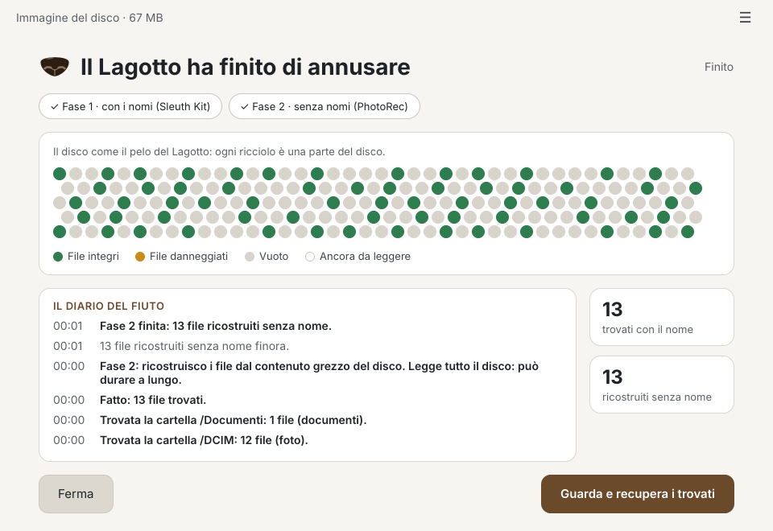
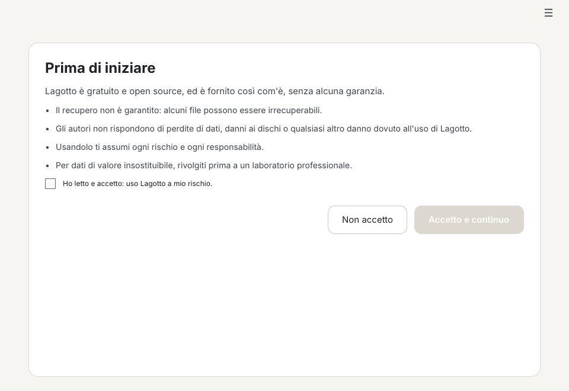
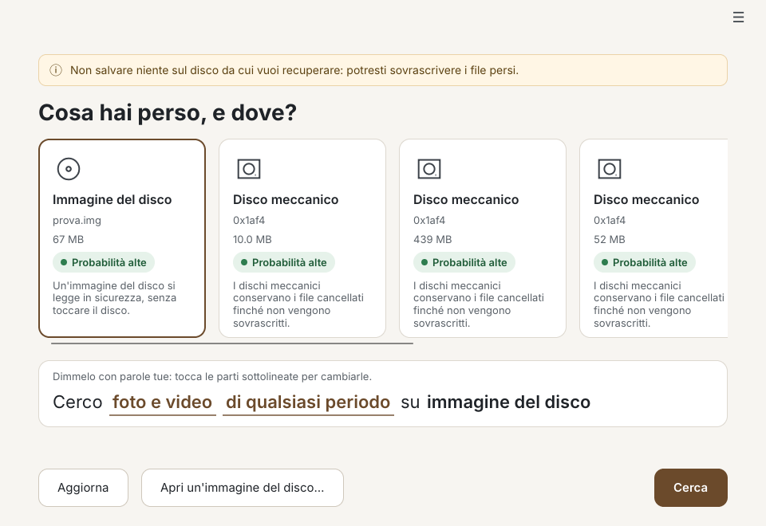
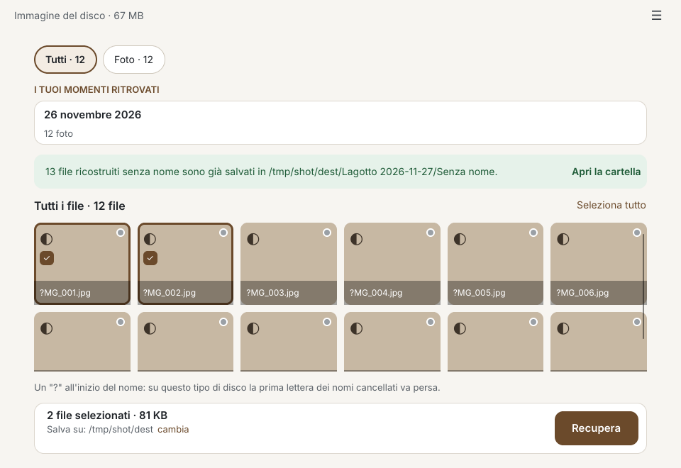

# Lagotto

**Trova i tuoi file cancellati e li riporta indietro.**

🇬🇧 [Read in English](README.md)

Lagotto è un'app gratuita e open source per recuperare i file su Linux. Prende il nome dal cane italiano da tartufo, che trova ciò che è sepolto. Dici cosa hai perso e dove, lasci che il Lagotto annusi il disco, scegli cosa riportare. **Non scrive mai sul disco da cui recuperi** e, prima di iniziare, ti dice con onestà quante probabilità ci sono.

<p align="center"></p>

> **Stato: primo sviluppo (tappa 0), non ancora rilasciato.** Funziona dall'inizio alla fine sulle immagini dei dischi ed è stato provato solo dalle verifiche automatiche e su immagini di prova. I dischi veri, con la finestra della password, l'autore non li ha ancora provati.
>
> **Fatto con l'AI:** Lagotto è scritto con un assistente AI. Vedi [Come è fatto Lagotto](#come-è-fatto-lagotto).


**Indice:** [Prima di iniziare](#prima-di-iniziare) · [Come funziona](#come-funziona) · [Cosa può e non può fare](#cosa-può-e-non-può-fare) · [Installazione](#installazione) · [Riga di comando](#la-riga-di-comando) · [Codici di errore](#quando-qualcosa-va-storto-codici-di-errore) · [Banco di prova](#il-banco-di-prova) · [Come è fatto Lagotto](#come-è-fatto-lagotto) · [Licenza](#licenza)

## Prima di iniziare

Lagotto è gratuito e open source, ed è fornito **così com'è, senza alcuna garanzia**. Il recupero non è garantito: alcuni file possono essere irrecuperabili. Gli autori non rispondono di perdite di dati, danni ai dischi o qualsiasi altro danno dovuto all'uso di Lagotto. **Usandolo ti assumi ogni rischio e ogni responsabilità.** Per dati di valore insostituibile, rivolgiti prima a un laboratorio professionale.

Al primo avvio Lagotto ti chiede di accettare questo avviso; senza accettazione non si può usare.

<p align="center"></p>

**Regole d'oro:** smetti di usare il disco da cui hai perso i file, e salva ciò che recuperi su **un altro** disco (Lagotto lo controlla per te).

## Come funziona

Tre passaggi, una sola finestra, un pulsante ☰ per il resto. Lagotto è uguale su KDE Plasma, GNOME, Xfce, Cinnamon e ogni altro ambiente desktop.

1. **Cosa hai perso, e dove?** Scegli il disco. Ogni disco mostra le sue probabilità: *alte* per chiavette, schede della fotocamera e dischi meccanici; *basse* per gli SSD che svuotano i file cancellati (TRIM) e per i dischi cifrati. Poi completa la frase *"Cerco foto e video di qualsiasi periodo sulla chiavetta USB"* toccando le parole sottolineate.
2. **Il Lagotto annusa, in due fasi.** La fase 1 trova i file cancellati con il loro nome (The Sleuth Kit); la fase 2, se la vuoi, ricostruisce i file senza nome dal contenuto grezzo (PhotoRec) e li salva subito in una cartella su un altro disco. Le due fasi sono indicate in alto, il disco è disegnato come il pelo riccio del Lagotto e il *diario del fiuto* racconta cosa succede, con parole normali. La fase 2 si può sospendere e riprendere. Sul disco da cui recuperi non viene scritto niente.
3. **I tuoi momenti ritrovati.** Foto e video vicini nel tempo diventano momenti, grazie alle date contenute nei file. Scegli i file o momenti interi, una cartella su un altro disco, e premi *Recupera*.

<p align="center"> </p>

Alla fine vedi quanti file sono tornati, quanto spazio occupano e quanti sono danneggiati (messi in una cartella a parte). I file non vengono mai sovrascritti: una seconda copia diventa `nome (1).jpg`. I doppioni vengono saltati, anche tra le due fasi: un file trovato con il nome non viene tenuto due volte.

## Cosa può e non può fare

| | |
|---|---|
| ✅ File cancellati **con il loro nome** | FAT, exFAT, NTFS, ext2/3/4, HFS e altri, con The Sleuth Kit. Sui dischi FAT la prima lettera dei nomi cancellati va persa: Lagotto la mostra come `?`. |
| ✅ File **senza nome**, dopo una formattazione | PhotoRec ricostruisce più di 480 tipi di file dal contenuto grezzo: *Cerca anche senza nomi…* dopo la prima fase. Si può sospendere e riprendere. |
| ✅ Immagini dei dischi | Apri un file `.img`/`.dd`: si legge in sicurezza. |
| ⚠️ ext4 | Quando un file viene cancellato, spesso il nome si perde; la ricerca grezza funziona comunque. |
| ❌ SSD con TRIM, dischi cifrati senza password, file sovrascritti | Nessun programma li riporta indietro. Lagotto lo dice prima di iniziare. |

Per leggere un disco vero servono i permessi di amministratore: Lagotto chiede la tua password una volta sola, con la solita finestra del tuo desktop, e un piccolo programma separato (`lagotto-helper`) legge il disco **in sola lettura**. La finestra di Lagotto gira sempre come utente normale.

## Installazione

**Fedora (e altre distribuzioni RPM):** scarica `lagotto-….rpm` dall'[ultima release](https://github.com/outlook791/Lagotto/releases/latest), poi:

```sh
sudo dnf install ./lagotto-*.rpm
```

Installa anche ciò che serve a Lagotto (The Sleuth Kit, TestDisk). Lagotto compare poi nel menu delle applicazioni. Per toglierlo: `sudo dnf remove lagotto`.

I pacchetti per le altre distribuzioni arriveranno.

**Dai sorgenti**, su qualsiasi distribuzione:

```sh
sudo dnf install cargo rust gcc fontconfig-devel libxkbcommon-devel sleuthkit testdisk perl-Image-ExifTool
git clone https://github.com/outlook791/Lagotto && cd Lagotto
cargo build --release
target/release/lagotto-gui
```

Su Debian/Ubuntu i pacchetti sono `cargo libfontconfig1-dev libxkbcommon-dev sleuthkit testdisk libimage-exiftool-perl` (Rust da rustup se quello della distribuzione è troppo vecchio).

Per provarlo in sicurezza senza un disco vero: `lagotto-gui disco.img` apre un'immagine del disco.

## La riga di comando

```sh
lagotto --accept-risk                 # una volta: accetta l'avviso
lagotto disks                         # dischi, tipo e probabilità
lagotto scan disco.img                # file cancellati con il nome
lagotto recover disco.img ~/Recuperati --kind photo
lagotto recover /dev/sdb ~/Recuperati --carve   # anche i file senza nome
```

`--json` dà un'uscita leggibile dai programmi.

## Quando qualcosa va storto: codici di errore

| Codice | Significato | Cosa fare |
|---|---|---|
| L101 | Manca un programma necessario | Installalo (vedi sopra) e riprova. |
| L102 | La destinazione è sul disco da cui recuperi | Scegli una cartella su un altro disco. |
| L103 | Spazio insufficiente | Libera spazio o scegli un disco più grande. |
| L104 | Il disco non si legge | Controlla il cavo; se fa rumori, fermati e fanne prima un'immagine. |
| L105 | Filesystem non riconosciuto | Cerca senza nomi (`--carve`). |
| L106 | Un programma esterno è fallito | Riprova; se succede di nuovo, segnalalo. |
| L107 | Permesso negato | Lagotto ha bisogno della tua password per leggere i dischi. |
| L108 | Non si può scrivere nella destinazione | Scegli una cartella in cui puoi scrivere. |

## Il banco di prova

Ogni modifica viene controllata in automatico: si creano immagini di dischi con file noti, se ne cancella una parte (e un'immagine viene formattata), Lagotto li recupera e il risultato si confronta byte per byte. La verifica fallisce se l'immagine sorgente cambia anche di poco. Oggi: FAT32 4/4 file cancellati tornati identici, FAT32 riformattata 4/4 senza nomi. Il caso ext4 usa una cancellazione più "gentile" di quella vera: prova la catena, non il recupero su ext4.

## Come è fatto Lagotto

Lagotto è scritto con un assistente AI (Claude, di Anthropic), guidato, provato e mantenuto dal suo autore, outlook791. Quasi tutto il codice, queste guide e le traduzioni sono generati dall'AI su sua richiesta. I motori di recupero sono gli strumenti open source collaudati The Sleuth Kit e PhotoRec/TestDisk: Lagotto li guida, unisce i risultati e controlla i file. L'interfaccia usa [Slint](https://slint.dev). Le traduzioni sono fatte con l'AI; le correzioni dei madrelingua sono benvenute.

## Licenza

GPL-3.0 o successive. Vedi [LICENSE](LICENSE).
