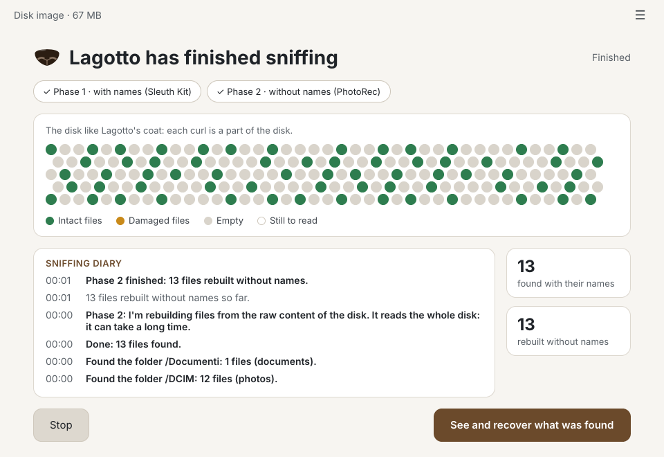
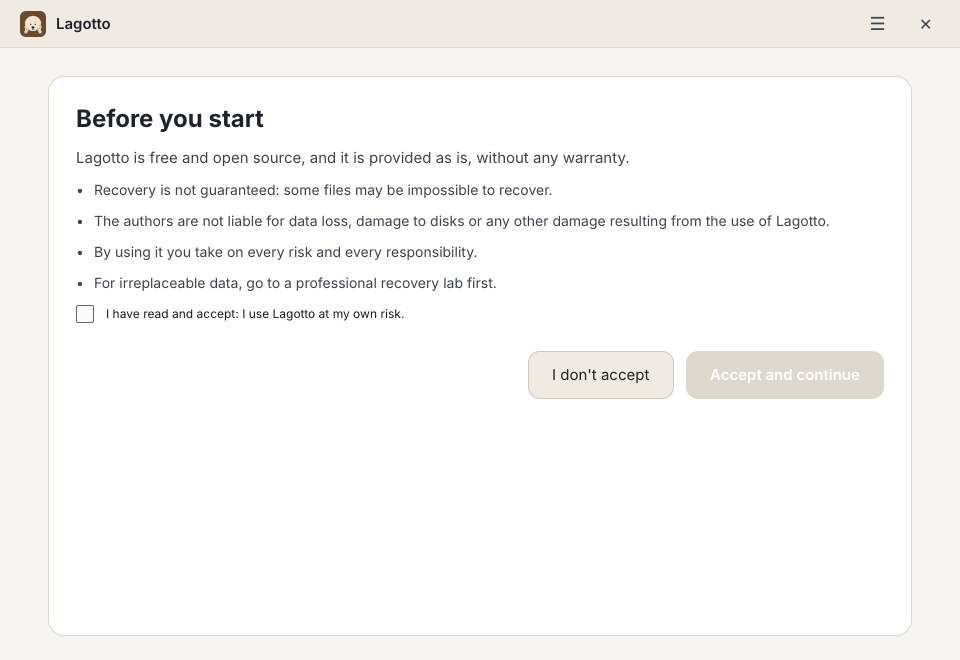
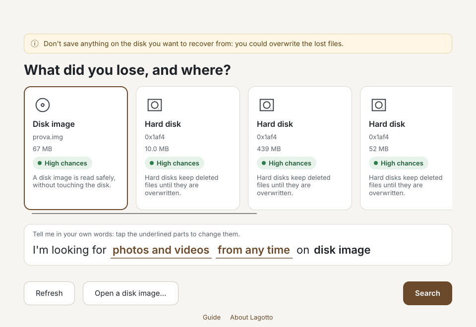
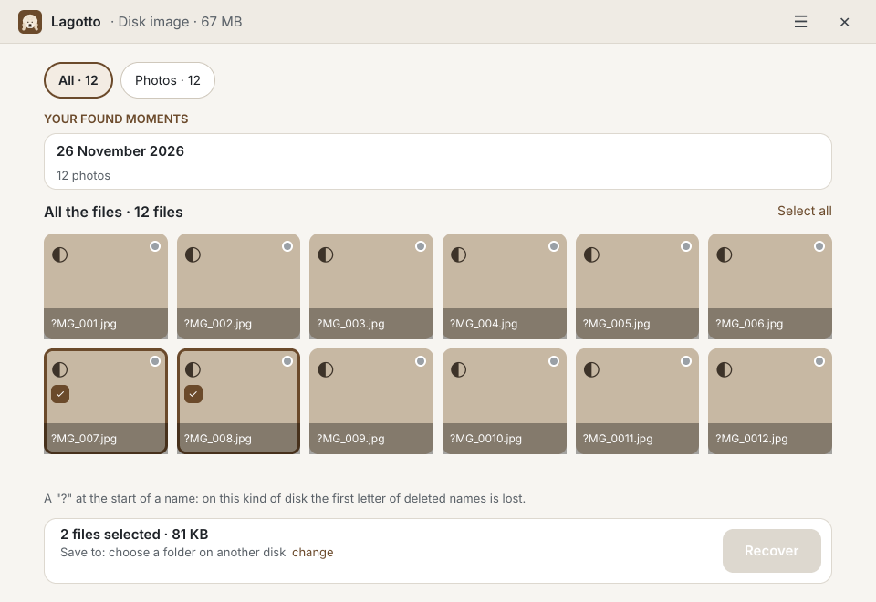

# Lagotto

**Finds your deleted files and brings them back.**

🇮🇹 [Leggi in italiano](README.it.md)

Lagotto is a free, open-source data recovery app for Linux, named after the Italian truffle dog that finds what is buried. Say what you lost and where, let Lagotto sniff the disk, choose what to bring back. It **never writes on the disk you recover from**, and it tells you honestly how likely recovery is before it starts.

<p align="center"></p>

> **Status: early development (tappa 0), not released yet.** It works end to end on disk images and has been tried only in automatic checks and on test images. Real disks through the password window have not been tried by the author yet.
>
> **Made with AI:** Lagotto is written with an AI assistant. See [How Lagotto is made](#how-lagotto-is-made).


**Contents:** [Before you start](#before-you-start) · [How it works](#how-it-works) · [What it can and cannot do](#what-it-can-and-cannot-do) · [Install](#install) · [Command line](#the-command-line) · [Error codes](#when-something-goes-wrong-error-codes) · [Test bench](#the-test-bench) · [How Lagotto is made](#how-lagotto-is-made) · [License](#license)

## Before you start

Lagotto is free and open source, and it is provided **as is, without any warranty**. Recovery is not guaranteed: some files may be impossible to recover. The authors are not liable for data loss, damage to disks or any other damage resulting from the use of Lagotto. **By using it you take on every risk and every responsibility.** For irreplaceable data, go to a professional recovery lab first.

Lagotto asks you to accept this the first time it starts; without acceptance it cannot be used.

<p align="center"></p>

**Golden rules:** stop using the disk you lost files from, and save what you recover on **another** disk (Lagotto checks this for you).

## How it works

Three steps, one window, a ☰ button for the rest. Lagotto looks the same on KDE Plasma, GNOME, Xfce, Cinnamon and every other desktop.

1. **What did you lose, and where?** Choose the disk. Each disk shows its chances: *high* for USB sticks, camera cards and hard disks; *low* for SSDs that empty deleted files (TRIM), and for encrypted disks. Then complete the sentence *"I'm looking for photos and videos from any time on the USB stick"* by tapping the underlined words.
2. **Lagotto sniffs.** The disk is drawn like Lagotto's curly coat, and the *sniffing diary* tells you what is happening in plain words. Nothing is written on the disk.
3. **Your found moments.** Photos and videos close in time are grouped into moments, from the dates inside the files. Choose files or whole moments, pick a folder on another disk, press *Recover*.

<p align="center"> </p>

At the end you get how many files came back, how much space they take and how many are damaged (kept in a separate folder). Files are never overwritten: a second copy becomes `name (1).jpg`. Duplicates are skipped.

## What it can and cannot do

| | |
|---|---|
| ✅ Deleted files **with their names** | FAT, exFAT, NTFS, ext2/3/4, HFS and more, through The Sleuth Kit. On FAT disks the first letter of deleted names is lost: Lagotto shows it as `?`. |
| ✅ Files **without names**, after formatting | PhotoRec rebuilds more than 480 kinds of files from raw content (command line `--carve` for now; in the window in a later release). |
| ✅ Disk images | Open a `.img`/`.dd` file: it is read safely. |
| ⚠️ ext4 | Names are often lost when a file is deleted; the raw search still works. |
| ❌ SSDs with TRIM, encrypted disks without the password, overwritten files | No program can bring these back. Lagotto says so before you start. |

Reading a real disk needs administrator permission: Lagotto asks for your password once, through your desktop's usual window, and a small separate program (`lagotto-helper`) reads the disk **read-only**. The window itself always runs as you.

## Install

**Fedora (and other RPM distributions):** download `lagotto-….rpm` from the [latest release](https://github.com/outlook791/Lagotto/releases/latest), then:

```sh
sudo dnf install ./lagotto-*.rpm
```

It also installs what Lagotto needs (The Sleuth Kit, TestDisk). Lagotto then appears in the app menu. To remove it: `sudo dnf remove lagotto`.

Packages for other distributions will follow.

**From the source**, on any distribution:

```sh
sudo dnf install cargo rust gcc fontconfig-devel libxkbcommon-devel sleuthkit testdisk perl-Image-ExifTool
git clone https://github.com/outlook791/Lagotto && cd Lagotto
cargo build --release
target/release/lagotto-gui
```

On Debian/Ubuntu the packages are `cargo libfontconfig1-dev libxkbcommon-dev sleuthkit testdisk libimage-exiftool-perl` (Rust from rustup if the distribution's is too old).

To try it safely without a real disk: `lagotto-gui disk.img` opens a disk image.

## The command line

```sh
lagotto --accept-risk                 # once: accept the notice
lagotto disks                         # disks, kind and chances
lagotto scan disk.img                 # deleted files with names
lagotto recover disk.img ~/Recovered --kind photo
lagotto recover /dev/sdb ~/Recovered --carve   # also files without names
```

`--json` gives machine-readable output.

## When something goes wrong: error codes

| Code | Meaning | What to do |
|---|---|---|
| L101 | A needed program is missing | Install it (see above) and try again. |
| L102 | The destination is on the disk you recover from | Choose a folder on another disk. |
| L103 | Not enough space | Free some space or choose a bigger disk. |
| L104 | The disk cannot be read | Check the cable; if it makes noises, stop and make an image first. |
| L105 | File system not recognised | Search without names (`--carve`). |
| L106 | An external program failed | Try again; if it happens again, report it. |
| L107 | Permission denied | Lagotto needs your password to read disks. |
| L108 | Cannot write to the destination | Choose a folder you can write to. |

## The test bench

Every change is checked automatically: test disk images are created with known files, some are deleted (and one image is formatted), Lagotto recovers them and the result is compared byte by byte. The check fails if the source image changes at all. Today: FAT32 4/4 deleted files back identical, re-formatted FAT32 4/4 without names. The ext4 case uses a gentler deletion than a real one, so it proves the chain, not ext4 recovery.

## How Lagotto is made

Lagotto is written with an AI assistant (Claude, by Anthropic), directed, tried and maintained by its author, outlook791. Nearly all of the code, these guides and the translations are generated by the AI from his requests. The recovery engines are the proven open-source tools The Sleuth Kit and PhotoRec/TestDisk; Lagotto drives them, merges their results and checks the files. The interface uses [Slint](https://slint.dev). Translations are made with AI; corrections by native speakers are welcome.

## License

GPL-3.0-or-later. See [LICENSE](LICENSE).
